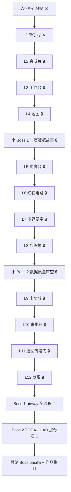

# 🗺️ BiomedCraft 世界地图

图例：🔒 未解锁 · ⚔️ 可开始/进行中 · ✅ 已通关 · 🐉 Boss

## 状态表

| 周 | 单元 | 状态 | 通关证据 |
|---|---|---|---|
| W0 | 终点预览 | ⚔️ | 预览 HTML + 3 个问题 |
| W1 | L1 新手村 | ⚔️ | `hello.txt` + `hello.html` + commit |
| W2 | L2 合成台 | 🔒 | 合成函数 + 测试 |
| W3 | L3 工作台 | 🔒 | 清洗脚本 + 数据字典 |
| W4 | L4 地图 | 🔒 | 4 张图 + 图注 |
| W4 | 小 Boss 1 | 🔒 | 一页报告 |
| W5 | L5 附魔台 | 🔒 | 统计小抄 + 模拟 |
| W6 | L6 红石电路 | 🔒 | 函数 + 错误日志 |
| W7 | L7 下界要塞 | 🔒 | 概念图 + 数据字典 |
| W8 | L8 烈焰棒 | 🔒 | QC 报告 |
| W8 | 小 Boss 2 | 🔒 | QC 清单 |
| W9 | L9 末地城 | 🔒 | DE 表 + 火山图 |
| W10 | L10 末地船 | 🔒 | 富集图 + 3 段解释 |
| W11 | L11 返回传送门 | 🔒 | Quarto 报告 |
| W12 | L12 龙蛋 | 🔒 | 限时分析 + 5 句话 |
| W13–14 | Boss 1 | 🐉 | airway 项目 |
| W15 | Boss 2（加分项） | 🐉 | TCGA-LUAD 项目 |
| W16 | 最终 Boss | 🐉 | pasilla + 公开作品集 |

## 更新规则

1. 关卡通关后，把状态改为 ✅，并在证据列写 commit 短哈希或文件链接。
2. 成就单独提交：`PROGRESS: claim A01`。
3. 每幕结束打 tag：`act-1`、`act-2`、`act-3`。
4. 每周打 tag：`w01`、`w02`。
