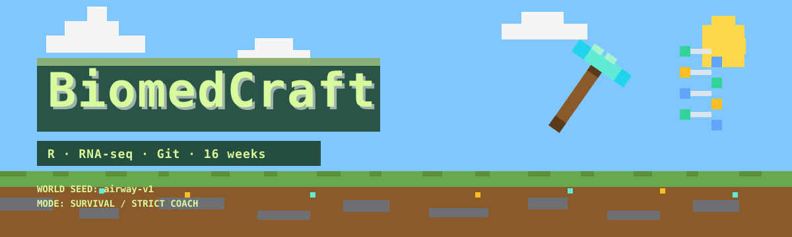

<div align="center">



# ⛏️ BiomedCraft

**一个生物医学大一学生的 R 语言生存存档**

<p>
  
  
  
  
  
  
</p>

> Minecraft-inspired learning repo. Not affiliated with Mojang or Microsoft. 本项目不使用官方素材。

</div>

---

## 🖥️ F3 状态栏

```text
▌ BIOMEDCRAFT v0.1.0
▌ Biome    主世界 · 新手村
▌ Mode     生存（严格教练，延迟给答案）
▌ Day      1 / 112
▌ XP       0 / 2700
▌ Quests   0 / 12
▌ Bosses   0 / 3
▌ Seed     airway-v1
▌ Save     main @ v0.1.0
```

## 📊 世界进度

| 维度 | 进度 | 完成 |
|---|---|---|
| 主世界 | `▱▱▱▱` | 0 / 4 |
| 下界 | `▱▱▱▱` | 0 / 4 |
| 末地 | `▱▱▱▱` | 0 / 4 |
| Boss | `▱▱▱` | 0 / 3 |

> 当前可进入：`W0 终点预览`、`L1 新手村`。

## 🗺️ 世界地图

| 维度 | 群系 | 关卡 | 状态 |
|---|---|---|---|
| 主世界 | 新手村 | L1 · 第一次进入世界 | ⚔️ 可开始 |
| 主世界 | 合成台 | L2 · 把材料组合成函数 | 🔒 |
| 主世界 | 工作台 | L3 · 清洗真实表格 | 🔒 |
| 主世界 | 地图 | L4 · 把数据画成图 | 🔒 |
| 主世界 | 村庄 | 小 Boss 1 · 一页数据故事 | 🔒 |
| 下界 | 附魔台 | L5 · 统计直觉 | 🔒 |
| 下界 | 红石电路 | L6 · 函数、迭代与调试 | 🔒 |
| 下界 | 要塞 | L7 · 基因数据是什么 | 🔒 |
| 下界 | 烈焰棒 | L8 · QC 与标准化 | 🔒 |
| 下界 | 堡垒 | 小 Boss 2 · 数据质量审查 | 🔒 |
| 末地 | 末地城 | L9 · 差异表达 | 🔒 |
| 末地 | 末地船 | L10 · 富集与解释 | 🔒 |
| 末地 | 返回传送门 | L11 · 热图与叙事 | 🔒 |
| 末地 | 龙蛋 | L12 · 独立分析 | 🔒 |
| Boss | 末影龙 | Boss 1 · airway 全流程 | 🐉 0% |
| Boss | 凋灵 | Boss 2 · TCGA-LUAD 加分项 | 🐉 0% |
| Boss | 远古守卫者 | 最终 Boss · pasilla + 作品集 | 🐉 0% |

完整状态见 [MAP.md](MAP.md)。

## 🧪 合成配方：一关是怎么通关的？

```text
┌──────────┬──────────┬──────────┐
│ 任务卡    │ 概念补给  │ 自己写    │
├──────────┼──────────┼──────────┤
│ 自检      │ 复盘      │ commit    │
└──────────┴──────────┴──────────┘
                ↓
        ✅ 通关 + 成就 + XP
```

| 材料 | 数量 | 获取方式 |
|---|---:|---|
| 任务卡 | 1 | 打开关卡 `README.md` |
| 概念补给 | 1 | 读 `concepts.qmd` |
| 亲手代码 | 1 | 自己写，不先看答案 |
| 自检 | 1 | 跑 `check_level_XX.R` |
| 复盘 | 1 | 三问 + 5 句话解释 |
| 存档 | 1 | `git commit` |

## ⚠️ 服务器规则

```text
▌ ⚠ 服务器规则
▌ 1. 先自己挖，再看攻略
▌ 2. 卡住 30 分钟才问 AI
▌ 3. 每周至少存两次档
▌ 4. 成就必须附证据链接
▌ 5. 最终 Boss 禁止 AI 代打
```

- `commit` = 保存世界
- 每周 `tag` = 存档点
- `act-1/2/3` tag = 传送门
- AI 是严格教练：先自己写，卡住只给提示，提交后才审查

## 🎮 操作说明

| 你想做的事 | Minecraft | BiomedCraft |
|---|---|---|
| 移动到下一关 | 走进传送门 | 打开下一关 `README.md` |
| 挖矿 | 左键长按 | 写代码、查文档 |
| 合成 | 工作台 | 把函数组合成分析 |
| 存档 | 自动保存 | `git commit` |
| 重生 | 睡床 | 写复盘 |
| 看坐标 | F3 | 看 [PROGRESS.md](PROGRESS.md) |

## 🏆 成就墙

| 图标 | 成就 | 条件 | 状态 |
|---|---|---|---|
|  | **木镐** | 第一次跑通 R 脚本 | 🔒 |
|  | **第一次合成** | 第一个 `dplyr` 管道或函数 | 🔒 |
|  | **工作台** | 完成一次可复现清洗 | 🔒 |
|  | **地图绘制者** | 第一张完整 `ggplot` | 🔒 |
|  | **附魔台** | 能解释一个统计概念 | 🔒 |
|  | **红石工程师** | 第一个可复用函数 | 🔒 |
| 🔒 | **下界通行证** | 读入并解释 `airway` | 🔒 |
| 🔒 | **QC 守门人** | 发现或排除一个数据质量问题 | 🔒 |
| 🔒 | **末地行者** | 完成一次差异表达 | 🔒 |
| 🔒 | **龙蛋** | 通关 Boss 1 | 🔒 |
| 🔒 | **村庄英雄** | 把富集结果讲给非专业听众 | 🔒 |
| 🔒 | **经验修补** | 四周后回访旧关卡并改进 | 🔒 |
| 🔒 | **传说的起点** | 公开发布第一个作品集 | 🔒 |

## 🐉 Boss 血条

| Boss | 血条 | 进度 |
|---|---|---|
| Boss 1 · airway 全流程 | `░░░░░░░░░░` | 0% |
| Boss 2 · TCGA-LUAD 加分项 | `░░░░░░░░░░` | 0% |
| 最终 Boss · pasilla + 作品集 | `░░░░░░░░░░` | 0% |

## 📖 当前任务书

- [ ] [00_setup/README.md](00_setup/README.md)：安装 R / Quarto / Git
- [ ] [00_setup/preview.qmd](00_setup/preview.qmd)：跑通终点预览
- [ ] [01_overworld/level-01-hello/README.md](01_overworld/level-01-hello/README.md)：L1 新手村
- [ ] 领取「木镐」成就

## 🚀 快速开始：进入世界

```bash
git clone https://github.com/legogogoagent/biomed-quest.git
cd biomed-quest
```

然后按 [00_setup/README.md](00_setup/README.md) 安装环境，再运行：

```bash
Rscript -e 'renv::restore()'
quarto render 00_setup/preview.qmd
```

## 📂 存档结构

```text
00_setup/       安装、环境检查、W0 预览
01_overworld/   L1–L4 + 小 Boss 1
02_nether/      L5–L8 + 小 Boss 2
03_end/         L9–L12
bosses/         Boss 任务与战报
data/           原始与处理后的数据
R/              可复用函数
journal/        每周复盘与 AI 日志
templates/      任务卡、复盘、审查模板
assets/badges/  自绘像素徽章
docs/           设计文档与学习笔记
```

## 📄 License

代码 MIT；教程文字 CC-BY-4.0；数据遵循原始来源许可证。

<div align="center">

**“先挖第一块石头，再想末影龙。”**

</div>
