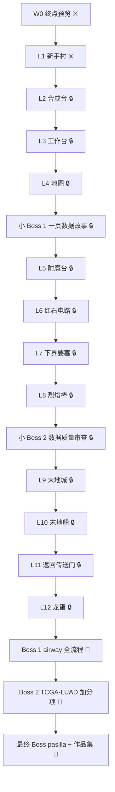

# BiomedCraft Release 0 Implementation Plan

> **For agentic workers:** REQUIRED SUB-SKILL: Use superpowers:subagent-driven-development (recommended) or superpowers:executing-plans to implement this plan task-by-task. Steps use checkbox (`- [ ]`) syntax for tracking.

**Goal:** Build the first working version of the BiomedCraft learning repo: Minecraft-style README/map/progress, setup guide, W0 preview, L1 quest, templates, badges, and a public portfolio skeleton.

**Architecture:** The current repository (`/home/aigc/Project/Biomedical`) becomes the public `biomed-quest` repo. A sibling directory (`/home/aigc/Project/biomed-portfolio`) becomes the public portfolio repo. Release 0 is content-first: static validation runs without R, while runtime validation (W0 render, L1 check) requires R and Quarto installed by the learner.

**Tech Stack:** R 4.2+, Quarto 1.5+, renv, tidyverse, pheatmap, Git, Bash.

---

## Environment prerequisite

Tasks 4, 5, and 9 require `Rscript` and `quarto`. If either is missing, run Task 3 first, or use the Linux fallback:

```bash
mamba create -y -n biomedcraft -c conda-forge r-base r-tidyverse r-pheatmap r-here r-janitor r-skimr r-renv quarto
mamba run -n biomedcraft Rscript -e 'install.packages("quarto", repos="https://cloud.r-project.org")'
```

Static validation (`scripts/validate_release0.sh`) works without R.

## File map

| Path | Responsibility |
|---|---|
| `README.md` | Minecraft-style save file, map, rules, achievements, quick start |
| `MAP.md` | Mermaid quest map and status table |
| `PROGRESS.md` | XP, level, achievements, weekly log |
| `_quarto.yml` | Quarto project config |
| `biomed-quest.Rproj` | RStudio project file |
| `scripts/validate_release0.sh` | Static Release 0 validator |
| `00_setup/README.md` | macOS/Linux install and first-commit guide |
| `00_setup/install_macos.sh` | macOS installer |
| `00_setup/install_linux.sh` | Linux installer with mamba fallback |
| `00_setup/verify_environment.R` | Runtime environment check |
| `data-raw/generate_preview_data.R` | Generates synthetic airway-style counts |
| `R/preview_analysis.R` | PCA, volcano, heatmap data for W0 |
| `00_setup/preview.qmd` | W0 rendered preview |
| `01_overworld/level-01-hello/*` | L1 task card, concepts, warm-up, quest, check, journal |
| `solutions/level-01-hello.R` | L1 reference solution |
| `templates/*` | Quest card, journal, AI log, review, boss report |
| `assets/badges/*.svg` | Original pixel-style badges |
| `../biomed-portfolio/*` | Public portfolio skeleton (separate repo) |

---

### Task 1: Repository skeleton and static validator

**Files:**
- Create: `.gitignore`
- Create: `_quarto.yml`
- Create: `biomed-quest.Rproj`
- Create: `scripts/validate_release0.sh`
- Create directories: `00_setup`, `01_overworld/level-01-hello`, `02_nether`, `03_end`, `bosses`, `data/raw`, `data/processed`, `data-raw`, `R`, `docs`, `journal`, `templates`, `solutions`, `assets/badges`, `scripts`

- [ ] **Step 1: Create the directory skeleton**

Run:

```bash
cd /home/aigc/Project/Biomedical
mkdir -p 00_setup 01_overworld/level-01-hello 02_nether 03_end bosses \
  data/raw data/processed data-raw R docs journal templates solutions \
  assets/badges scripts
```

Expected: no output, directories exist.

- [ ] **Step 2: Write `.gitignore`**

Create `.gitignore`:

```gitignore
# R / RStudio
.Rproj.user/
.Rhistory
.RData
.Ruserdata
renv/library/
renv/python/
renv/staging/

# Quarto
.Rproj.user
*_files/
/.quarto/

# Generated learner output
output/
data/processed/*
!data/processed/.gitkeep

# Large data
data/raw/*.rds
data/raw/*.h5
data/raw/*.h5ad
data/raw/*.bam
data/raw/*.fastq
data/raw/*.fastq.gz

# OS / editor
.DS_Store
Thumbs.db
.vscode/
.idea/
```

Run:

```bash
touch data/processed/.gitkeep
```

Expected: `data/processed/.gitkeep` exists.

- [ ] **Step 3: Write Quarto and RStudio project files**

Create `_quarto.yml`:

```yaml
project:
  type: default
editor: visual
```

Create `biomed-quest.Rproj`:

```text
Version: 1.0

RestoreWorkspace: No
SaveWorkspace: No
AlwaysSaveHistory: No

EnableCodeIndexing: Yes
UseSpacesForTab: Yes
NumSpacesForTab: 2
Encoding: UTF-8

RnwWeave: knitr
LaTeX: XeLaTeX
```

Expected: both files exist at the repo root.

- [ ] **Step 4: Write the static validator**

Create `scripts/validate_release0.sh`:

```bash
#!/usr/bin/env bash
set -u

ROOT="$(cd "$(dirname "${BASH_SOURCE[0]}")/.." && pwd)"
cd "$ROOT"

ok=0
fail=0

pass() { echo "✅ $1"; ok=$((ok + 1)); }
fault() { echo "❌ $1"; fail=$((fail + 1)); }

check_file() {
  if [[ -f "$1" ]]; then pass "file $1"; else fault "missing file $1"; fi
}

check_contains() {
  if [[ -f "$1" ]] && grep -qF "$2" "$1"; then
    pass "$1 contains '$2'"
  else
    fault "$1 missing '$2'"
  fi
}

check_file "README.md"
check_file "MAP.md"
check_file "PROGRESS.md"
check_file ".gitignore"
check_file "_quarto.yml"
check_file "biomed-quest.Rproj"
check_file "data/README.md"
check_file "journal/ai-log.md"
check_file "00_setup/README.md"
check_file "00_setup/preview.qmd"
check_file "00_setup/verify_environment.R"
check_file "data-raw/generate_preview_data.R"
check_file "data/raw/preview_counts.csv"
check_file "data/raw/preview_metadata.csv"
check_file "R/preview_analysis.R"
check_file "01_overworld/level-01-hello/README.md"
check_file "01_overworld/level-01-hello/concepts.qmd"
check_file "01_overworld/level-01-hello/warmup.R"
check_file "01_overworld/level-01-hello/quest.R"
check_file "01_overworld/level-01-hello/check_level_01.R"
check_file "01_overworld/level-01-hello/journal.md"
check_file "01_overworld/level-01-hello/hello.qmd"
check_file "solutions/level-01-hello.R"
check_file "templates/quest-card.md"
check_file "templates/journal.md"
check_file "templates/ai-log.md"
check_file "templates/code-review.md"
check_file "templates/boss-report.md"
check_file "docs/README.md"

check_contains "README.md" "BiomedCraft"
check_contains "README.md" "世界地图"
check_contains "README.md" "成就墙"
check_contains "README.md" "快速开始"
check_contains "README.md" "Minecraft-inspired"
check_contains "MAP.md" "flowchart"
check_contains "MAP.md" "L12"
check_contains "PROGRESS.md" "2700"
check_contains "PROGRESS.md" "A13"
check_contains "01_overworld/level-01-hello/README.md" "5 句话"

badges=$(find assets/badges -maxdepth 1 -name '*.svg' | wc -l | tr -d ' ')
if [[ "$badges" -ge 6 ]]; then
  pass "at least 6 SVG badges ($badges)"
else
  fault "expected at least 6 SVG badges, found $badges"
fi

if grep -RIn --exclude-dir=.git --exclude-dir=renv --exclude='*.svg' --exclude='*.html' "TBD" \
  README.md MAP.md PROGRESS.md 00_setup 01_overworld templates 2>/dev/null; then
  fault "found TBD placeholder"
else
  pass "no TBD placeholder in Release 0 content"
fi

if grep -RIn --exclude-dir=.git --exclude-dir=renv --exclude='*.svg' --exclude='*.html' "/home/" \
  R 00_setup 01_overworld 2>/dev/null; then
  fault "found absolute /home/ path in R or Quarto content"
else
  pass "no absolute /home/ paths"
fi

echo
echo "Passed: $ok  Failed: $fail"
if [[ "$fail" -gt 0 ]]; then
  exit 1
fi
echo "✅ Release 0 static validation passed"
```

Run:

```bash
chmod +x scripts/validate_release0.sh
bash scripts/validate_release0.sh
```

Expected: FAIL, listing many missing files.

- [ ] **Step 5: Commit the skeleton**

Run:

```bash
git add .gitignore _quarto.yml biomed-quest.Rproj scripts/validate_release0.sh data/processed/.gitkeep
git commit -m "chore: scaffold BiomedCraft repo and validator"
```

Expected: commit created.

---

### Task 2: Minecraft-style README, map, and progress

**Files:**
- Create: `README.md`
- Create: `MAP.md`
- Create: `PROGRESS.md`
- Create: `docs/README.md`

- [ ] **Step 1: Write `README.md`**

Create `README.md`:

````markdown
# ⛏️ BiomedCraft
> 一个生物医学大一学生的 R 语言生存存档

🟩 当前境界：Lv.0 迷路的村民
❤️ 模式：生存（严格教练，延迟给答案）
🌍 世界种子：airway-v1
📦 进度：0/12 关卡 · 0/3 Boss
🏆 成就：0/13

> Minecraft-inspired learning repo. Not affiliated with Mojang or Microsoft. 本项目不使用官方素材。

## 🗺️ 世界地图

```text
主世界   新手村 → 合成台 → 工作台 → 地图
            ↓ 传送门
下界     附魔台 → 红石电路 → 要塞 → 烈焰棒
            ↓ 传送门
末地     末地城 → 末地船 → 返回传送门 → 龙蛋
```

完整状态见 [MAP.md](MAP.md)，经验和成就见 [PROGRESS.md](PROGRESS.md)。

## 📜 游戏规则

- commit = 保存世界
- 每周 tag = 存档点
- act-1/2/3 tag = 传送门
- 成就必须附证据链接
- AI 是严格教练：先自己写，卡住只给提示，提交后才审查
- 每周至少 2 次 commit、1 篇复盘

## 🏆 成就墙

| 成就 | 条件 | 状态 |
|---|---|---|
| 木镐 | 第一次跑通 R 脚本 | 🔒 |
| 第一次合成 | 第一个 `dplyr` 管道或函数 | 🔒 |
| 工作台 | 完成一次可复现清洗 | 🔒 |
| 地图绘制者 | 第一张完整 `ggplot` | 🔒 |
| 附魔台 | 能解释一个统计概念 | 🔒 |
| 红石工程师 | 第一个可复用函数 | 🔒 |
| 下界通行证 | 读入并解释 `airway` | 🔒 |
| QC 守门人 | 发现或排除一个数据质量问题 | 🔒 |
| 末地行者 | 完成一次差异表达 | 🔒 |
| 龙蛋 | 通关 Boss 1 | 🔒 |
| 村庄英雄 | 把富集结果讲给非专业听众 | 🔒 |
| 经验修补 | 四周后回访旧关卡并改进 | 🔒 |
| 传说的起点 | 公开发布第一个作品集 | 🔒 |

## 🚀 快速开始

```bash
cd ~/Project/Biomedical
Rscript -e 'renv::restore()'
quarto render 00_setup/preview.qmd
```

第一次使用先读 [00_setup/README.md](00_setup/README.md)。

## 📂 存档结构

```text
00_setup/       安装、环境检查、W0 预览
01_overworld/   L1–L4 + 小 Boss 1
02_nether/      L5–L8 + 小 Boss 2
03_end/         L9–L12
bosses/         Boss 任务与战报
data/           原始与处理后的数据
R/              可复用函数
journal/        每周复盘与 AI 日志
templates/      任务卡、复盘、审查模板
assets/badges/  自绘像素徽章
docs/           设计文档与学习笔记
```

## 🧭 当前任务

- [00_setup/README.md](00_setup/README.md)：安装环境
- [00_setup/preview.qmd](00_setup/preview.qmd)：跑通终点预览
- [01_overworld/level-01-hello/README.md](01_overworld/level-01-hello/README.md)：L1 新手村

## 📄 License

代码 MIT；教程文字 CC-BY-4.0；数据遵循原始来源许可证。
````

- [ ] **Step 2: Write `MAP.md`**

Create `MAP.md`:

````markdown
# 🗺️ BiomedCraft 世界地图

图例：🔒 未解锁 · ⚔️ 可开始/进行中 · ✅ 已通关 · 🐉 Boss



## 状态表

| 周 | 单元 | 状态 | 通关证据 |
|---|---|---|---|
| W0 | 终点预览 | ⚔️ | 预览 HTML + 3 个问题 |
| W1 | L1 新手村 | ⚔️ | `hello.txt` + `hello.html` + commit |
| W2 | L2 合成台 | 🔒 | 合成函数 + 测试 |
| W3 | L3 工作台 | 🔒 | 清洗脚本 + 数据字典 |
| W4 | L4 地图 | 🔒 | 4 张图 + 图注 |
| W4 | 小 Boss 1 | 🔒 | 一页报告 |
| W5 | L5 附魔台 | 🔒 | 统计小抄 + 模拟 |
| W6 | L6 红石电路 | 🔒 | 函数 + 错误日志 |
| W7 | L7 下界要塞 | 🔒 | 概念图 + 数据字典 |
| W8 | L8 烈焰棒 | 🔒 | QC 报告 |
| W8 | 小 Boss 2 | 🔒 | QC 清单 |
| W9 | L9 末地城 | 🔒 | DE 表 + 火山图 |
| W10 | L10 末地船 | 🔒 | 富集图 + 3 段解释 |
| W11 | L11 返回传送门 | 🔒 | Quarto 报告 |
| W12 | L12 龙蛋 | 🔒 | 限时分析 + 5 句话 |
| W13–14 | Boss 1 | 🐉 | airway 项目 |
| W15 | Boss 2（加分项） | 🐉 | TCGA-LUAD 项目 |
| W16 | 最终 Boss | 🐉 | pasilla + 公开作品集 |

## 更新规则

1. 关卡通关后，把状态改为 ✅，并在证据列写 commit 短哈希或文件链接。
2. 成就单独提交：`PROGRESS: claim A01`。
3. 每幕结束打 tag：`act-1`、`act-2`、`act-3`。
4. 每周打 tag：`w01`、`w02`。
````

- [ ] **Step 3: Write `PROGRESS.md`**

Create `PROGRESS.md`:

```markdown
# 🎮 玩家进度

| 属性 | 当前值 |
|---|---|
| 玩家 | 生物医学大一学生 |
| 模式 | 生存（严格教练） |
| 等级 | Lv.0 迷路的村民 |
| XP | 0 / 2700 |
| 关卡 | 0 / 12 |
| 小 Boss | 0 / 2 |
| Boss | 0 / 3 |
| 成就 | 0 / 13 |

## 等级阈值

| 等级 | XP | 名称 |
|---|---:|---|
| Lv.0 | 0 | 迷路的村民 |
| Lv.1 | 400 | 石匠 |
| Lv.2 | 900 | 红石学徒 |
| Lv.3 | 1500 | 炼金术士 |
| Lv.4 | 2100 | 末地行者 |
| Lv.5 | 2700 | 生物医学数据分析师 |

XP 只来自单元通关：12 关 × 100 + 2 个小 Boss × 150 + 3 个 Boss × 400 = 2700。
成就只发徽章，不额外加 XP。Boss 2 是加分项；跳过时最高 Lv.4。

## 成就清单

- [ ] A01 木镐
- [ ] A02 第一次合成
- [ ] A03 工作台
- [ ] A04 地图绘制者
- [ ] A05 附魔台
- [ ] A06 红石工程师
- [ ] A07 下界通行证
- [ ] A08 QC 守门人
- [ ] A09 末地行者
- [ ] A10 龙蛋
- [ ] A11 村庄英雄
- [ ] A12 经验修补
- [ ] A13 传说的起点

## 每周日志

| 周 | 关卡 | 本周产出 | 卡点 | 下周调整 | commit |
|---|---|---|---|---|---|
| W0 | 终点预览 |  |  |  |  |
| W1 | L1 |  |  |  |  |

## 更新规则

1. 每次通关：更新 XP、等级、关卡数、成就复选框。
2. 每次成就：单独 commit，信息为 `PROGRESS: claim A01`。
3. 每周日：补一行日志，写清卡点和下周调整。
```

- [ ] **Step 4: Write `docs/README.md`**

Create `docs/README.md`:

```markdown
# Docs

- [设计文档](../superpowers/specs/2026-10-27-biomedcraft-r-learning-design.md)
- [Release 0 实施计划](../superpowers/plans/2026-10-27-biomedcraft-release-0.md)
```

- [ ] **Step 5: Validate and commit**

Run:

```bash
bash scripts/validate_release0.sh
```

Expected: still FAIL, but README/MAP/PROGRESS checks pass.

Commit:

```bash
git add README.md MAP.md PROGRESS.md docs/README.md
git commit -m "docs: add Minecraft-style README, map, and progress"
```

---

### Task 3: Setup guide, installers, environment check, renv

**Files:**
- Create: `00_setup/README.md`
- Create: `00_setup/install_macos.sh`
- Create: `00_setup/install_linux.sh`
- Create: `00_setup/verify_environment.R`
- Create: `dependencies.R`

- [ ] **Step 1: Write the setup guide**

Create `00_setup/README.md`:

````markdown
# 🛠️ 00_setup：进入世界之前

目标：在 macOS 或 Linux 上安装 R、Quarto、Git，安装 R 包，初始化 `renv`，完成第一次 commit。

## 1. 安装

### macOS

```bash
brew install r quarto git
brew install --cask rstudio
```

如果没有 Homebrew，先按 https://brew.sh 安装。

### Linux（Ubuntu/Debian）

有 `mamba` 或 `conda` 时，推荐用独立环境，避免污染系统：

```bash
mamba create -y -n biomedcraft -c conda-forge \
  r-base r-tidyverse r-pheatmap r-here r-janitor r-skimr r-renv quarto
mamba run -n biomedcraft Rscript -e 'install.packages("quarto", repos="https://cloud.r-project.org")'
```

没有 `mamba` 且有 `sudo` 时：

```bash
sudo apt-get update
sudo apt-get install -y r-base r-base-dev git curl
QUARTO_URL=$(curl -fsSL https://api.github.com/repos/quarto-dev/quarto-cli/releases/latest \
  | grep -o 'https://[^"]*linux-amd64.deb' | head -n 1)
curl -fL -o /tmp/quarto.deb "$QUARTO_URL"
sudo dpkg -i /tmp/quarto.deb
```

### 一键脚本

```bash
bash 00_setup/install_macos.sh
# 或
bash 00_setup/install_linux.sh
```

## 2. 安装 R 包

```bash
Rscript -e 'install.packages(c("renv","tidyverse","pheatmap","here","janitor","skimr","quarto"), repos="https://cloud.r-project.org")'
```

## 3. 初始化 renv

```bash
Rscript -e 'renv::init(restart = FALSE)'
Rscript -e 'renv::snapshot()'
```

成功后仓库根目录会出现 `renv.lock`、`renv/`、`.Rprofile`。

## 4. 检查环境

```bash
Rscript 00_setup/verify_environment.R
```

期望：每行都是 ✅，最后输出“环境检查通过”。

## 5. 第一次 commit

```bash
git add .Rprofile renv.lock renv
git commit -m "chore: initialize renv"
```

## 常见问题

- `Rscript: command not found`：R 没装好，或 PATH 没更新。macOS 用 `brew doctor`；Linux 用 `which R` 检查。
- `quarto: command not found`：重新安装 Quarto，确认 `/usr/local/bin` 或 conda 环境在 PATH 中。
- `renv::init()` 卡住：先确认能访问 CRAN；公司/学校网络可能需要配置代理。
- Linux 没有 sudo：用 mamba/conda 方案，不要强行 `sudo`。
````

- [ ] **Step 2: Write the macOS installer**

Create `00_setup/install_macos.sh`:

```bash
#!/usr/bin/env bash
set -euo pipefail

if ! command -v brew >/dev/null 2>&1; then
  echo "❌ 未找到 Homebrew。请先安装：https://brew.sh"
  exit 1
fi

echo "==> 安装 R、Quarto、Git"
brew install r quarto git

echo "==> 安装 RStudio（可选，已安装会跳过）"
brew install --cask rstudio || true

echo "==> 安装 R 包"
Rscript -e 'install.packages(c("renv","tidyverse","pheatmap","here","janitor","skimr","quarto"), repos="https://cloud.r-project.org")'

echo "==> 初始化 renv"
Rscript -e 'if (!file.exists("renv.lock")) renv::init(restart = FALSE)'
Rscript -e 'renv::snapshot()'

echo "✅ macOS 环境安装完成。下一步：Rscript 00_setup/verify_environment.R"
```

- [ ] **Step 3: Write the Linux installer**

Create `00_setup/install_linux.sh`:

```bash
#!/usr/bin/env bash
set -euo pipefail

if command -v mamba >/dev/null 2>&1; then
  echo "==> 使用 mamba 创建 biomedcraft 环境"
  mamba create -y -n biomedcraft -c conda-forge \
    r-base r-tidyverse r-pheatmap r-here r-janitor r-skimr r-renv quarto
  mamba run -n biomedcraft Rscript -e 'install.packages("quarto", repos="https://cloud.r-project.org")'
  mamba run -n biomedcraft Rscript -e 'if (!file.exists("renv.lock")) renv::init(restart = FALSE)'
  mamba run -n biomedcraft Rscript -e 'renv::snapshot()'
  echo "✅ 已创建环境。下一步：conda activate biomedcraft && Rscript 00_setup/verify_environment.R"
  exit 0
fi

if ! command -v sudo >/dev/null 2>&1; then
  echo "❌ 没有 sudo，也没有 mamba/conda。请安装 mamba 或手动安装 R/Quarto。"
  exit 1
fi

echo "==> 安装 R、Git、curl"
sudo apt-get update
sudo apt-get install -y r-base r-base-dev git curl

echo "==> 安装最新版 Quarto"
QUARTO_URL=$(curl -fsSL https://api.github.com/repos/quarto-dev/quarto-cli/releases/latest \
  | grep -o 'https://[^"]*linux-amd64.deb' | head -n 1)
if [[ -z "${QUARTO_URL}" ]]; then
  echo "❌ 没能找到 Quarto 的 .deb 下载地址，请手动安装：https://quarto.org/docs/get-started/"
  exit 1
fi
curl -fL -o /tmp/quarto.deb "$QUARTO_URL"
sudo dpkg -i /tmp/quarto.deb

echo "==> 安装 R 包"
Rscript -e 'install.packages(c("renv","tidyverse","pheatmap","here","janitor","skimr","quarto"), repos="https://cloud.r-project.org")'

echo "==> 初始化 renv"
Rscript -e 'if (!file.exists("renv.lock")) renv::init(restart = FALSE)'
Rscript -e 'renv::snapshot()'

echo "✅ Linux 环境安装完成。下一步：Rscript 00_setup/verify_environment.R"
```

- [ ] **Step 4: Write the environment check**

Create `00_setup/verify_environment.R`:

```r
#!/usr/bin/env Rscript

ok <- 0L
fail <- 0L

pass <- function(msg) {
  cat("✅", msg, "\n")
  ok <<- ok + 1L
}

fault <- function(msg, hint = "") {
  cat("❌", msg, "\n")
  if (nzchar(hint)) cat("   提示：", hint, "\n")
  fail <<- fail + 1L
}

check <- function(name, condition, detail = "", hint = "") {
  if (isTRUE(condition)) {
    pass(paste0(name, if (nzchar(detail)) paste0(" (", detail, ")") else ""))
  } else {
    fault(name, hint)
  }
}

check("R >= 4.2", getRversion() >= "4.2", as.character(getRversion()),
      "升级 R：https://cran.r-project.org")

packages <- c("tidyverse", "pheatmap", "here", "janitor", "skimr", "renv", "quarto")
for (pkg in packages) {
  check(
    paste0("R package ", pkg),
    requireNamespace(pkg, quietly = TRUE),
    hint = paste0('运行 install.packages("', pkg, '")')
  )
}

quarto_version <- tryCatch(
  system2("quarto", "--version", stdout = TRUE, stderr = TRUE),
  error = function(e) ""
)
check("quarto CLI", length(quarto_version) > 0 && nzchar(quarto_version[[1]]),
      paste(quarto_version, collapse = " "),
      "安装 Quarto：https://quarto.org/docs/get-started/")

git_version <- tryCatch(
  system2("git", "--version", stdout = TRUE, stderr = TRUE),
  error = function(e) ""
)
check("git", length(git_version) > 0 && nzchar(git_version[[1]]),
      paste(git_version, collapse = " "),
      "安装 Git：https://git-scm.com")

cat("\nPassed:", ok, " Failed:", fail, "\n")
if (fail > 0) {
  quit(status = 1)
}
cat("🎉 环境检查通过，可以进入 W0。\n")
```

- [ ] **Step 5: Syntax-check installers and run static validation**

Run:

```bash
bash -n 00_setup/install_macos.sh
bash -n 00_setup/install_linux.sh
bash scripts/validate_release0.sh
```

Expected: `bash -n` no output; validator still reports missing W0/L1 files.

- [ ] **Step 6: Initialize renv if R is available**

Create `dependencies.R`:

```r
# Dependency anchor for renv.
# These packages are used in setup checks and learner-facing tutorials.
library(tidyverse)
library(janitor)
library(skimr)
library(pheatmap)
library(here)
library(quarto)
```

Run:

```bash
if command -v Rscript >/dev/null 2>&1; then
  Rscript -e 'if (!file.exists("renv.lock")) renv::init(restart = FALSE)'
  Rscript -e 'renv::snapshot()'
fi
```

Expected: if R is installed, `renv.lock`, `renv/`, and `.Rprofile` exist; otherwise the step is skipped and the setup guide will create them on the learner's machine.

- [ ] **Step 7: Commit**

```bash
git add 00_setup/README.md 00_setup/install_macos.sh 00_setup/install_linux.sh 00_setup/verify_environment.R dependencies.R
if [[ -f renv.lock ]]; then git add .Rprofile renv.lock renv; fi
git commit -m "docs: add cross-platform setup and environment check"
```

---

### Task 4: W0 preview data, analysis, and Quarto report

**Files:**
- Create: `data-raw/generate_preview_data.R`
- Create: `data/raw/README.md`
- Generate: `data/raw/preview_counts.csv`
- Generate: `data/raw/preview_metadata.csv`
- Create: `R/preview_analysis.R`
- Create: `00_setup/preview.qmd`

- [ ] **Step 1: Write the synthetic data generator**

Create `data-raw/generate_preview_data.R`:

```r
#!/usr/bin/env Rscript

# 生成 airway 风格的合成 count 数据，仅用于 W0 预览。
# 真实 airway 数据在 L7 引入。

set.seed(42)

genes <- sprintf("GENE%02d", 1:40)
samples <- c("ctrl_1", "ctrl_2", "ctrl_3", "trt_1", "trt_2", "trt_3")
condition <- rep(c("control", "treated"), each = 3)

base_expression <- rpois(length(genes), lambda = 200)
counts <- matrix(0, nrow = length(genes), ncol = length(samples),
                 dimnames = list(genes, samples))

for (i in seq_along(samples)) {
  counts[, i] <- rnbinom(length(genes), mu = base_expression, size = 20)
}

# 前 8 个基因在处理组中上调约 10 倍，制造可检测的信号。
counts[1:8, 4:6] <- round(counts[1:8, 4:6] * 10)
counts <- round(counts)

dir.create("data/raw", recursive = TRUE, showWarnings = FALSE)

counts_df <- data.frame(gene = genes, counts, check.names = FALSE)
write.csv(counts_df, "data/raw/preview_counts.csv", row.names = FALSE)

metadata_df <- data.frame(
  sample = samples,
  condition = condition,
  stringsAsFactors = FALSE
)
write.csv(metadata_df, "data/raw/preview_metadata.csv", row.names = FALSE)

cat("✅ 生成 data/raw/preview_counts.csv（40 genes × 6 samples）\n")
cat("✅ 生成 data/raw/preview_metadata.csv（3 control + 3 treated）\n")
```

Run:

```bash
Rscript data-raw/generate_preview_data.R
```

Expected:

```text
✅ 生成 data/raw/preview_counts.csv（40 genes × 6 samples）
✅ 生成 data/raw/preview_metadata.csv（3 control + 3 treated）
```

- [ ] **Step 2: Write the data provenance note**

Create `data/raw/README.md`:

```markdown
# Data Sources

## preview_counts.csv / preview_metadata.csv

- 来源：`data-raw/generate_preview_data.R` 生成的合成数据。
- 用途：W0 终点预览，只演示“count → QC → 差异表达 → 可视化”的流程。
- 规模：40 个基因 × 6 个样本（3 control，3 treated）。
- 信号：前 8 个基因在 treated 组上调约 10 倍。
- 许可证：MIT（与仓库代码相同）。

真实 `airway` 数据在 L7 通过 Bioconductor 引入，不放入本目录。
```

Create `data/README.md`:

```markdown
# Data

| 目录 | 内容 | 是否提交 |
|---|---|---|
| `raw/` | 原始或生成的输入数据 | 小文件提交；大文件只提交下载脚本 |
| `processed/` | 可复现生成的中间数据 | 不提交，保留 `.gitkeep` |

规则：

- 每个数据集都要在 `raw/README.md` 写来源、许可证、规模和预处理。
- 不提交个人数据、密钥、受控访问数据或超过 50 MB 的文件。
- 公开作品集只放下载脚本和衍生图，不放大数据。
```

- [ ] **Step 3: Write the preview analysis script**

Create `R/preview_analysis.R`:

```r
#!/usr/bin/env Rscript

suppressPackageStartupMessages({
  library(readr)
  library(dplyr)
  library(tidyr)
  library(tibble)
})

counts <- read_csv("data/raw/preview_counts.csv", show_col_types = FALSE)
metadata <- read_csv("data/raw/preview_metadata.csv", show_col_types = FALSE)

count_matrix <- counts |>
  column_to_rownames("gene") |>
  as.matrix()

log_matrix <- log2(count_matrix + 1)

# PCA：看样本是否按条件分开
pca <- prcomp(t(log_matrix), scale. = TRUE)
pca_df <- as.data.frame(pca$x[, 1:2]) |>
  rownames_to_column("sample") |>
  left_join(metadata, by = "sample")

# 简化的差异表达：t 检验 + BH 校正（仅用于预览，正式分析用 DESeq2）
de_results <- lapply(rownames(log_matrix), function(gene) {
  control <- log_matrix[gene, metadata$condition == "control"]
  treated <- log_matrix[gene, metadata$condition == "treated"]
  tibble(
    gene = gene,
    mean_control = mean(control),
    mean_treated = mean(treated),
    log2fc = mean(treated) - mean(control),
    p_value = t.test(control, treated)$p.value
  )
}) |>
  bind_rows() |>
  mutate(p_adj = p.adjust(p_value, method = "BH")) |>
  arrange(p_value)

# 热图：取最显著的 15 个基因
top_genes <- de_results |>
  slice_head(n = 15) |>
  pull(gene)

heatmap_df <- as.data.frame(log_matrix[top_genes, , drop = FALSE]) |>
  rownames_to_column("gene")

dir.create("data/processed", recursive = TRUE, showWarnings = FALSE)

write_csv(pca_df, "data/processed/preview_pca.csv")
write_csv(de_results, "data/processed/preview_volcano.csv")
write_csv(heatmap_df, "data/processed/preview_heatmap.csv")

cat("✅ PCA:", nrow(pca_df), "samples\n")
cat("✅ DE:", nrow(de_results), "genes; significant (padj < 0.05):",
    sum(de_results$p_adj < 0.05, na.rm = TRUE), "\n")
cat("✅ Heatmap:", nrow(heatmap_df), "genes\n")
```

Run:

```bash
Rscript R/preview_analysis.R
```

Expected:

```text
✅ PCA: 6 samples
✅ DE: 40 genes; significant (padj < 0.05): 8
✅ Heatmap: 15 genes
```

- [ ] **Step 4: Write the W0 Quarto report**

Create `00_setup/preview.qmd`:

````qmd
---
title: "W0 终点预览：从 count 到生物学"
subtitle: "BiomedCraft · 先看看终点长什么样"
format:
  html:
    toc: true
    code-fold: true
execute:
  echo: true
  warning: false
  message: false
---

```{r}
#| label: setup
library(readr)
library(dplyr)
library(ggplot2)
library(pheatmap)
library(tibble)
library(here)

pca <- read_csv(here("data", "processed", "preview_pca.csv"), show_col_types = FALSE)
volcano <- read_csv(here("data", "processed", "preview_volcano.csv"), show_col_types = FALSE)
metadata <- read_csv(here("data", "raw", "preview_metadata.csv"), show_col_types = FALSE)
heatmap_df <- read_csv(here("data", "processed", "preview_heatmap.csv"), show_col_types = FALSE)
```

## 1. 这批样本像不像两组？

```{r}
#| label: pca
ggplot(pca, aes(x = PC1, y = PC2, color = condition, label = sample)) +
  geom_point(size = 4) +
  geom_text(vjust = -0.8, size = 3) +
  labs(
    title = "PCA: samples separate by condition",
    x = "PC1",
    y = "PC2",
    color = "Condition"
  ) +
  theme_minimal()
```

> 人话：如果两组样本在 PCA 上分开，说明处理效应比样本间噪声更明显。

## 2. 哪些基因发生了变化？

```{r}
#| label: volcano
volcano |>
  mutate(significant = p_adj < 0.05) |>
  ggplot(aes(x = log2fc, y = -log10(p_value), color = significant)) +
  geom_point(size = 2) +
  geom_vline(xintercept = 0, linetype = "dashed", color = "grey50") +
  geom_hline(yintercept = -log10(0.05), linetype = "dashed", color = "grey50") +
  labs(
    title = "Volcano plot: treated vs control",
    x = "log2 fold change",
    y = "-log10(p-value)",
    color = "padj < 0.05"
  ) +
  theme_minimal()
```

> 人话：越靠右上/左上的基因，变化越大、证据越强。这里只是预览，正式分析要用 DESeq2。

## 3. 显著基因长什么样？

```{r}
#| label: heatmap
#| fig-width: 7
#| fig-height: 5

heat_matrix <- heatmap_df |>
  column_to_rownames("gene") |>
  as.matrix()

annotation_col <- metadata |>
  column_to_rownames("sample") |>
  select(condition)

pheatmap(
  heat_matrix,
  scale = "row",
  cluster_rows = TRUE,
  cluster_cols = TRUE,
  annotation_col = annotation_col,
  main = "Top 15 genes (row-scaled log2 counts)",
  fontsize_row = 8
)
```

> 人话：热图把“哪些基因在哪些样本里高/低”压缩成颜色。聚类告诉你样本和基因是否成群。

## 4. 你现在需要做什么？

1. 把这份报告渲染出来。
2. 写下 3 个你现在看不懂的问题。
3. 保存到 `journal/w00.md`。

## 5. 环境

```{r}
#| label: session
sessionInfo()
```
````

- [ ] **Step 5: Run the W0 pipeline**

Run:

```bash
Rscript data-raw/generate_preview_data.R
Rscript R/preview_analysis.R
quarto render 00_setup/preview.qmd
```

Expected:

- `data/raw/preview_counts.csv` and `preview_metadata.csv` exist.
- `data/processed/preview_pca.csv`, `preview_volcano.csv`, `preview_heatmap.csv` exist.
- `00_setup/preview.html` exists and opens with 3 plots.

- [ ] **Step 6: Commit**

```bash
git add data-raw/generate_preview_data.R data/README.md data/raw/README.md data/raw/preview_counts.csv data/raw/preview_metadata.csv
git add R/preview_analysis.R 00_setup/preview.qmd
git commit -m "feat: add W0 synthetic preview and Quarto report"
```

---

### Task 5: L1 新手村 content and reference solution

**Files:**
- Create: `01_overworld/level-01-hello/README.md`
- Create: `01_overworld/level-01-hello/concepts.qmd`
- Create: `01_overworld/level-01-hello/warmup.R`
- Create: `01_overworld/level-01-hello/quest.R`
- Create: `01_overworld/level-01-hello/hello.qmd`
- Create: `01_overworld/level-01-hello/check_level_01.R`
- Create: `01_overworld/level-01-hello/journal.md`
- Create: `solutions/level-01-hello.R`

- [ ] **Step 1: Write the L1 task card**

Create `01_overworld/level-01-hello/README.md`:

```markdown
# L1 新手村：第一次进入世界

⏱️ 预计 4–5 小时（核心 3 小时 + 可选 2 小时）
🏆 成就：木镐
🎯 目标：完成第一份玩家档案，跑通 R → Quarto → Git 的最小闭环。

## 为什么做这个

你不需要先学完所有语法。先完成一个能运行、能渲染、能提交的小作品，知道“一个 R 项目长什么样”。

## 任务

1. 读 `concepts.qmd`，认识对象、向量、数据框、函数。
2. 运行 `warmup.R`，看输出。
3. 编辑 `quest.R`，把 TODO 换成你的信息。
4. 编辑 `hello.qmd`，让它读取 `output/hello.txt` 并显示。
5. 运行 `check_level_01.R`，直到全部 ✅。
6. 渲染 `hello.qmd`。
7. 写 `journal.md` 的复盘三问 + 5 句话解释。
8. commit，并在 `PROGRESS.md` 领取木镐。

## 通关条件

- `Rscript 01_overworld/level-01-hello/quest.R` 能运行。
- `output/hello.txt` 至少 3 行，包含等级信息。
- `01_overworld/level-01-hello/hello.html` 存在。
- `check_level_01.R` 全部 ✅。
- `journal.md` 完成。
- 至少 1 次 commit。

## 5 句话解释

1. 这关解决了什么问题？
2. 输入是什么、输出是什么？
3. 关键函数为什么选它？
4. 结果说明什么？
5. 还有什么不确定？

## 卡住了怎么办

- 先看报错最后一行。
- 用 `?函数名` 查文档。
- 在 `journal/ai-log.md` 记录问题，再让 AI 给一级提示，不要直接要代码。
```

- [ ] **Step 2: Write the concepts page**

Create `01_overworld/level-01-hello/concepts.qmd`:

````qmd
---
title: "L1 概念补给：R 世界的基本方块"
format: html
---

## English TL;DR

- R stores data in objects; vectors are the basic 1D container.
- A data frame is a table with named columns.
- Functions take inputs, do work, and return outputs.
- RStudio has four useful panes: source, console, environment, files/plots.
- Quarto turns code and text into a report; Git saves versions.

## 1. 对象：给数据起名字

```{r}
player_name <- "Alex"
player_level <- 1
```

`<-` 是赋值。左边是名字，右边是值。

## 2. 向量：一排同类数据

```{r}
goals <- c("完成 W0", "通过 L1", "写下解释")
goals
length(goals)
```

`c()` 把多个值组合成一个向量。向量里的元素类型要一致。

## 3. 数据框：一张表

```{r}
player <- data.frame(
  name = c("Alex", "Steve"),
  level = c(1, 2),
  goal = c("学 R", "做分析")
)
player
str(player)
summary(player)
```

- 每一列是一个变量。
- 每一行是一个观测。
- `str()` 看结构，`summary()` 看摘要。

## 4. 函数：可重复的动作

```{r}
greet <- function(name, level) {
  paste0("欢迎，", name, "！你现在是 Lv.", level)
}

greet("Alex", 1)
```

函数让重复动作只写一次。参数是输入，返回值是输出。

## 5. RStudio 的四个窗格

| 窗格 | 用途 |
|---|---|
| Source | 写脚本，保存为 `.R` |
| Console | 立即运行一行代码 |
| Environment | 看当前有哪些对象 |
| Files / Plots / Help | 文件、图、文档 |

## 6. Quarto：代码 + 文字 = 报告

Quarto 文件是 `.qmd`。代码放在三个反引号加 `{r}` 的 chunk 里，文字用 Markdown 写。点击 Render 生成 HTML。

## 7. Git：保存世界

- `git status`：看发生了什么变化。
- `git add 文件`：把变化放进存档。
- `git commit -m "说明"`：真正保存一个版本。
- `git log --oneline`：看历史。

## 自检问题

1. `<-` 和 `=` 在这个关卡里都能赋值，但社区更常用哪个？
2. 向量和数据框的区别是什么？
3. 函数没有 `return()` 时，返回什么？
4. `str()` 和 `summary()` 各看什么？
5. commit 之前为什么要先 `git status`？
````

- [ ] **Step 3: Write the warm-up**

Create `01_overworld/level-01-hello/warmup.R`:

```r
# L1 热身：运行我，观察输出
# 命令：Rscript 01_overworld/level-01-hello/warmup.R

name <- "新手玩家"
level <- 1
goals <- c("跑通 R 脚本", "完成第一次 commit", "写下 5 句话解释")

cat("玩家：", name, "\n")
cat("等级：Lv.", level, "\n")
cat("目标：\n")
print(goals)

player <- data.frame(
  name = name,
  level = level,
  goal = goals
)

print(player)
str(player)
summary(player)
```

Run:

```bash
Rscript 01_overworld/level-01-hello/warmup.R
```

Expected: prints the player, a 3-row data frame, `str()` output, and `summary()` output.

- [ ] **Step 4: Write the quest starter**

Create `01_overworld/level-01-hello/quest.R`:

```r
# L1 主任务：建立你的玩家档案
# 运行：Rscript 01_overworld/level-01-hello/quest.R

player_name <- "你的名字"   # 改成你的名字
player_level <- 1
goals <- c("目标 1", "目标 2", "目标 3")  # 改成你自己的 3 个目标

player <- data.frame(
  name = player_name,
  level = player_level,
  goal = goals
)

print(player)
print(summary(player))

# 你的任务：
# 1. 创建 output/ 目录（提示：dir.create()）
# 2. 用 writeLines() 把玩家名、等级、目标写入 output/hello.txt
# 3. 运行本脚本，然后运行 check_level_01.R
```

- [ ] **Step 5: Write the hello Quarto starter**

Create `01_overworld/level-01-hello/hello.qmd`:

````qmd
---
title: "L1 玩家档案"
format: html
---

```{r}
# 读取 output/hello.txt 并打印
# 提示：readLines("output/hello.txt")
```
````

- [ ] **Step 6: Write the check script**

Create `01_overworld/level-01-hello/check_level_01.R`:

```r
#!/usr/bin/env Rscript

ok <- TRUE

say <- function(condition, message, hint = "") {
  if (isTRUE(condition)) {
    cat("✅", message, "\n")
  } else {
    cat("❌", message, "\n")
    if (nzchar(hint)) cat("   提示：", hint, "\n")
    ok <<- FALSE
  }
}

root <- here::here()
out_txt <- file.path(root, "output", "hello.txt")
out_html <- file.path(root, "01_overworld", "level-01-hello", "hello.html")

say(file.exists(out_txt), "找到 output/hello.txt",
    "先运行 quest.R，并用 writeLines() 写入文件。")

if (file.exists(out_txt)) {
  lines <- readLines(out_txt, warn = FALSE)
  say(length(lines) >= 3, "hello.txt 至少 3 行",
      "写入玩家名、等级和至少 3 个目标。")
  say(any(grepl("Lv|等级", lines)), "包含等级信息",
      "用 paste() 写入等级，例如 paste('等级: Lv', player_level)。")
}

say(file.exists(out_html), "找到 hello.html",
    "运行 quarto render 01_overworld/level-01-hello/hello.qmd")

if (!ok) {
  cat("\n还没通关。按上面的提示改，然后再运行一次。\n")
  quit(status = 1)
}

cat("\n🎉 L1 通关！别忘了写 5 句话解释并领取「木镐」成就。\n")
```

- [ ] **Step 7: Write the journal template**

Create `01_overworld/level-01-hello/journal.md`:

```markdown
# L1 复盘

## 三问

1. 哪一步最卡？
2. 报错说明了什么？
3. 下次如何更快？

## 5 句话解释

1. 这关解决了什么问题？
2. 输入是什么、输出是什么？
3. 关键函数为什么选它？
4. 结果说明什么？
5. 还有什么不确定？

## AI 日志

- 本次提问：
- 提示级别：
- 我采纳了什么：
- 我拒绝/改写了什么：
```

Create `journal/ai-log.md`:

```markdown
# AI 日志

规则：

- 先自己尝试，卡住再记录。
- 只请求一级提示；30 分钟后才可请求最小示例。
- 每次记录采纳、拒绝和改写。
- 最终 Boss 期间不记录代码生成请求，因为不允许 AI 写代码。

| 日期 | 关卡 | 我的问题 | 提示级别 | 采纳 | 拒绝/改写 | 下次先查什么 |
|---|---|---|---|---|---|---|
|  |  |  |  |  |  |  |
```

- [ ] **Step 8: Write the reference solution**

Create `solutions/level-01-hello.R`:

```r
#!/usr/bin/env Rscript

# L1 参考解：通关后解锁。先自己尝试，再看这里。

player_name <- "Alex"
player_level <- 1
goals <- c("完成 W0 预览", "通过 L1 自检", "写下 5 句话解释")

player <- data.frame(
  name = player_name,
  level = player_level,
  goal = goals
)

print(player)
print(summary(player))

dir.create(here::here("output"), showWarnings = FALSE)
writeLines(
  c(
    paste("玩家:", player_name),
    paste("等级: Lv", player_level),
    paste("目标:", paste(goals, collapse = " / "))
  ),
  here::here("output", "hello.txt")
)

quarto::quarto_render(
  here::here("01_overworld", "level-01-hello", "hello.qmd")
)

cat("✅ 参考解完成：output/hello.txt 和 hello.html 已生成\n")
```

- [ ] **Step 9: Test the failing and passing states**

Run the starter check:

```bash
Rscript 01_overworld/level-01-hello/check_level_01.R
```

Expected: exit 1 with ❌ for missing `output/hello.txt` and `hello.html`.

Run the reference solution:

```bash
Rscript solutions/level-01-hello.R
Rscript 01_overworld/level-01-hello/check_level_01.R
```

Expected: all ✅ and `🎉 L1 通关！`.

Clean generated learner output:

```bash
rm -rf output
rm -f 01_overworld/level-01-hello/hello.html
```

- [ ] **Step 10: Commit**

```bash
git add 01_overworld/level-01-hello solutions/level-01-hello.R journal/ai-log.md
git commit -m "feat: add L1 new-player quest and reference solution"
```

---

### Task 6: Templates

**Files:**
- Create: `templates/quest-card.md`
- Create: `templates/journal.md`
- Create: `templates/ai-log.md`
- Create: `templates/code-review.md`
- Create: `templates/boss-report.md`

- [ ] **Step 1: Write the quest card template**

Create `templates/quest-card.md`:

```markdown
# LXX 关卡名

⏱️ 预计：
🏆 成就：
🎯 目标：

## 背景

## 任务

1.
2.
3.

## 通关条件

- [ ] 自检脚本通过
- [ ] 复盘三问完成
- [ ] 5 句话解释完成
- [ ] commit 完成

## 卡住了怎么办

- 先读报错最后一行
- 用 `?函数名` 查文档
- 记录到 AI 日志，再要一级提示
```

- [ ] **Step 2: Write the journal template**

Create `templates/journal.md`:

```markdown
# WXX 复盘

## 本周产出

## 三问

1. 哪一步最卡？
2. 报错说明了什么？
3. 下次如何更快？

## 5 句话解释

1. 这关解决了什么问题？
2. 输入是什么、输出是什么？
3. 关键函数为什么选它？
4. 结果说明什么？
5. 还有什么不确定？

## 下周调整
```

- [ ] **Step 3: Write the AI log template**

Create `templates/ai-log.md`:

```markdown
# AI 日志

| 日期 | 关卡 | 我的问题 | 提示级别 | 采纳 | 拒绝/改写 | 下次先查什么 |
|---|---|---|---|---|---|---|
|  |  |  | 一级/二级/三级 |  |  |  |
```

- [ ] **Step 4: Write the code review template**

Create `templates/code-review.md`:

```markdown
# 代码审查

## 正确性

- [ ] 代码能从头运行
- [ ] 结果与预期一致
- [ ] 边界情况有说明

## 可复现性

- [ ] 没有绝对路径
- [ ] 依赖已记录
- [ ] 报告附 `sessionInfo()`

## 统计解释

- [ ] 方法选择有理由
- [ ] 结果解释没有超出数据
- [ ] 局限性和不确定性写明

## 可读性

- [ ] 变量名能看懂
- [ ] 关键步骤有注释
- [ ] 没有复制粘贴的死代码
```

- [ ] **Step 5: Write the boss report template**

Create `templates/boss-report.md`:

```markdown
# Boss 战报

## 问题

## 数据

## 方法

## 结果

## 局限性

## 复现步骤

## 5 分钟自讲提纲

1.
2.
3.
```

- [ ] **Step 6: Commit**

```bash
git add templates
git commit -m "docs: add quest, journal, AI log, review, and boss templates"
```

---

### Task 7: Pixel-style badges

**Files:**
- Create: `assets/badges/A01-wooden-pickaxe.svg`
- Create: `assets/badges/A02-first-craft.svg`
- Create: `assets/badges/A03-workbench.svg`
- Create: `assets/badges/A04-map-maker.svg`
- Create: `assets/badges/A05-enchanting-table.svg`
- Create: `assets/badges/A06-redstone-engineer.svg`
- Create: `assets/badges/README.md`

- [ ] **Step 1: Generate six original SVG badges**

Run:

```bash
mkdir -p assets/badges

make_badge() {
  local file="$1" zh="$2" en="$3" bg="$4" fg="$5"
  cat > "assets/badges/$file" <<EOF
<svg xmlns="http://www.w3.org/2000/svg" width="128" height="128" viewBox="0 0 128 128" role="img" aria-label="$zh">
  <rect width="128" height="128" rx="12" fill="$bg"/>
  <rect x="12" y="12" width="104" height="104" fill="none" stroke="$fg" stroke-width="4"/>
  <rect x="20" y="20" width="16" height="16" fill="$fg" opacity="0.35"/>
  <rect x="92" y="20" width="16" height="16" fill="$fg" opacity="0.35"/>
  <rect x="20" y="92" width="16" height="16" fill="$fg" opacity="0.35"/>
  <rect x="92" y="92" width="16" height="16" fill="$fg" opacity="0.35"/>
  <text x="64" y="60" text-anchor="middle" font-family="monospace" font-size="16" font-weight="bold" fill="$fg">$zh</text>
  <text x="64" y="84" text-anchor="middle" font-family="monospace" font-size="9" fill="$fg">$en</text>
</svg>
EOF
}

make_badge "A01-wooden-pickaxe.svg" "木镐" "WOODEN PICKAXE" "#3b2a1a" "#d9a441"
make_badge "A02-first-craft.svg" "第一次合成" "FIRST CRAFT" "#1f3320" "#8fd38f"
make_badge "A03-workbench.svg" "工作台" "WORKBENCH" "#33261a" "#e0b36a"
make_badge "A04-map-maker.svg" "地图绘制者" "MAP MAKER" "#1c2b33" "#7fd3e0"
make_badge "A05-enchanting-table.svg" "附魔台" "ENCHANTING TABLE" "#2a1c33" "#c58fe0"
make_badge "A06-redstone-engineer.svg" "红石工程师" "REDSTONE ENGINEER" "#331c1c" "#e07f7f"

echo "✅ generated $(find assets/badges -maxdepth 1 -name '*.svg' | wc -l) badges"
```

Expected: `✅ generated 6 badges`.

- [ ] **Step 2: Write the badge note**

Create `assets/badges/README.md`:

```markdown
# Badges

这些徽章是自绘像素风 SVG，不使用 Minecraft 官方材质、Logo 或字体。

- 未解锁：README 表格显示 🔒。
- 已解锁：把对应成就的 🔒 改成徽章图片链接。
- 新增徽章：复制一个 SVG，改颜色、中文名和英文名。

徽章不是奖励本身；证据链接才是。
```

- [ ] **Step 3: Validate SVG files**

Run:

```bash
python3 - <<'PY'
from pathlib import Path
import xml.etree.ElementTree as ET

svgs = sorted(Path("assets/badges").glob("*.svg"))
assert len(svgs) >= 6, f"expected >= 6 svgs, found {len(svgs)}"
for path in svgs:
    ET.parse(path)
print(f"✅ parsed {len(svgs)} SVG badges")
PY
```

Expected: `✅ parsed 6 SVG badges`.

- [ ] **Step 4: Commit**

```bash
git add assets/badges
git commit -m "feat: add original pixel-style achievement badges"
```

---

### Task 8: Public portfolio skeleton

**Files:**
- Create: `/home/aigc/Project/biomed-portfolio/README.md`
- Create: `/home/aigc/Project/biomed-portfolio/LICENSE`
- Create: `/home/aigc/Project/biomed-portfolio/LICENSE-text`
- Create: `/home/aigc/Project/biomed-portfolio/.gitignore`
- Create: `/home/aigc/Project/biomed-portfolio/projects/.gitkeep`

- [ ] **Step 1: Create the sibling repo**

Run:

```bash
mkdir -p /home/aigc/Project/biomed-portfolio/projects
cd /home/aigc/Project/biomed-portfolio
git init -b main
```

Expected: `Initialized empty Git repository`.

- [ ] **Step 2: Write the portfolio README**

Create `/home/aigc/Project/biomed-portfolio/README.md`:

```markdown
# BiomedPortfolio

> 从 R 零基础到独立基因分析的项目作品集。

这是 BiomedCraft 学习仓库的公开作品集。完整学习过程在公开的 BiomedCraft 仓库；这里只放完成并审查过的项目。

## 项目

| 项目 | 主题 | 状态 |
|---|---|---|
| 01-airway-rnaseq | airway RNA-seq 差异表达全流程 | 计划中 |
| 02-tcga-luad | TCGA-LUAD 肿瘤 vs 正常（加分项） | 计划中 |

项目会在 Boss 1 完成后逐步加入。

## 每个项目包含

- 英文 README + 中文摘要
- 问题、数据、方法、结果、局限性
- 可复现的 Quarto 报告
- `sessionInfo()` 和依赖说明
- 数据来源与许可证

## 许可证

- 代码：MIT（见 `LICENSE`）
- 文字：CC-BY-4.0（见 `LICENSE-text`）
- 数据：遵循原始来源许可证
```

- [ ] **Step 3: Write the licenses**

Create `/home/aigc/Project/biomed-portfolio/LICENSE`:

```text
MIT License

Copyright (c) 2026 BiomedPortfolio contributors

Permission is hereby granted, free of charge, to any person obtaining a copy
of this software and associated documentation files (the "Software"), to deal
in the Software without restriction, including without limitation the rights
to use, copy, modify, merge, publish, distribute, sublicense, and/or sell
copies of the Software, and to permit persons to whom the Software is
furnished to do so, subject to the following conditions:

The above copyright notice and this permission notice shall be included in all
copies or substantial portions of the Software.

THE SOFTWARE IS PROVIDED "AS IS", WITHOUT WARRANTY OF ANY KIND, EXPRESS OR
IMPLIED, INCLUDING BUT NOT LIMITED TO THE WARRANTIES OF MERCHANTABILITY,
FITNESS FOR A PARTICULAR PURPOSE AND NONINFRINGEMENT. IN NO EVENT SHALL THE
AUTHORS OR COPYRIGHT HOLDERS BE LIABLE FOR ANY CLAIM, DAMAGES OR OTHER
LIABILITY, WHETHER IN AN ACTION OF CONTRACT, TORT OR OTHERWISE, ARISING FROM,
OUT OF OR IN CONNECTION WITH THE SOFTWARE OR THE USE OR OTHER DEALINGS IN THE
SOFTWARE.
```

Create `/home/aigc/Project/biomed-portfolio/LICENSE-text`:

```text
The text content of this repository is licensed under the
Creative Commons Attribution 4.0 International License (CC-BY-4.0).

You are free to share and adapt the text for any purpose, provided you give
appropriate credit.

Full license: https://creativecommons.org/licenses/by/4.0/legalcode
```

- [ ] **Step 4: Write `.gitignore` and keep the projects directory**

Create `/home/aigc/Project/biomed-portfolio/.gitignore`:

```gitignore
.DS_Store
.Rproj.user/
.Rhistory
.RData
renv/library/
*_files/
/.quarto/
```

Run:

```bash
touch /home/aigc/Project/biomed-portfolio/projects/.gitkeep
```

- [ ] **Step 5: Commit the portfolio skeleton**

Run:

```bash
cd /home/aigc/Project/biomed-portfolio
git add README.md LICENSE LICENSE-text .gitignore projects/.gitkeep
git commit -m "chore: scaffold public portfolio"
git log --oneline -1
```

Expected: one commit in the portfolio repo.

---

### Task 9: Final validation, release tag, and handoff

**Files:**
- Modify: `docs/README.md` if needed
- Verify: all Release 0 files

- [ ] **Step 1: Run static validation**

Run:

```bash
cd /home/aigc/Project/Biomedical
bash scripts/validate_release0.sh
```

Expected:

```text
✅ Release 0 static validation passed
```

If it fails, fix the reported file or string, then rerun.

- [ ] **Step 2: Run environment and runtime checks**

Run:

```bash
Rscript -e 'renv::restore()'
Rscript 00_setup/verify_environment.R
Rscript data-raw/generate_preview_data.R
Rscript R/preview_analysis.R
quarto render 00_setup/preview.qmd
```

Expected:

- All environment checks ✅, ending with `🎉 环境检查通过`.
- `✅ PCA: 6 samples`, `✅ DE: 40 genes; significant (padj < 0.05): 8`, `✅ Heatmap: 15 genes`.
- `00_setup/preview.html` exists.

- [ ] **Step 3: Verify L1 fail/pass cycle**

Run:

```bash
rm -rf output
rm -f 01_overworld/level-01-hello/hello.html
Rscript 01_overworld/level-01-hello/check_level_01.R
```

Expected: exit 1, ❌ for missing `output/hello.txt` and `hello.html`.

Then run:

```bash
Rscript solutions/level-01-hello.R
Rscript 01_overworld/level-01-hello/check_level_01.R
```

Expected: all ✅ and `🎉 L1 通关！`.

Clean up:

```bash
rm -rf output
rm -f 01_overworld/level-01-hello/hello.html
```

- [ ] **Step 4: Check for secrets and accidental data**

Run:

```bash
git status --short
git ls-files | grep -Ei '\.(env|key|pem|csv)$' || true
```

Expected: only intended CSV preview files are tracked; no `.env`, keys, or personal data.

- [ ] **Step 5: Commit the remaining spec update and tag Release 0**

Run:

```bash
git add docs/superpowers/specs/2026-10-27-biomedcraft-r-learning-design.md \
  docs/superpowers/plans/2026-10-27-biomedcraft-release-0.md
git commit -m "docs: finalize Release 0 design and plan"
git log --oneline -5
```

Expected: commits for skeleton, README, setup, W0, L1, templates, badges.

- [ ] **Step 6: Write the handoff note**

Create `journal/w00-handoff.md`:

```markdown
# Release 0 Handoff

## 已完成

- 公开学习库骨架
- Minecraft 风 README、地图、进度
- macOS/Linux 安装与环境检查
- W0 终点预览
- L1 新手村与参考解
- 模板与 6 枚徽章
- 公开作品集骨架

## 下一步

1. 运行 `00_setup/install_*.sh` 安装环境。
2. 跑通 `00_setup/preview.qmd`。
3. 完成 L1，领取木镐。
4. 进入 W2（L2 合成台）。

## 需要用户确认

- 已推送到 GitHub 公开远程（legogogoagent/biomed-quest）。
- 是否现在创建公开作品集远程。
```

Commit:

```bash
git add journal/w00-handoff.md
git commit -m "docs: add Release 0 handoff note"
git tag v0.1.0
git tag
```

Expected: `v0.1.0` is listed.

---

## Self-review

- **Spec coverage:** README/MAP/PROGRESS, setup, W0, L1, templates, badges, portfolio, and release validation are each covered by a task.
- **Placeholder scan:** The only `TODO` text is inside the L1 starter code, where it is intentional learner work. No plan step says "implement later".
- **Type consistency:** File paths, achievement IDs (`A01`–`A13`), XP totals (2700), and level thresholds match the design spec.
- **Runtime dependency:** R/Quarto are required for Tasks 4, 5, and 9; the static validator and `bash -n` checks run without them.
